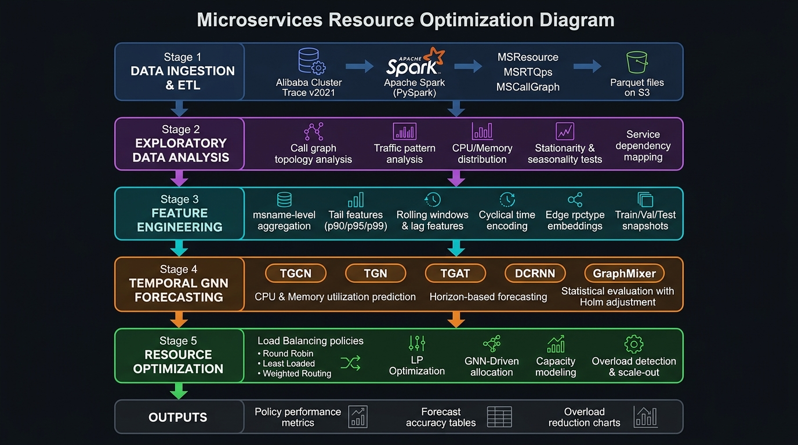

# 🔬 Microservices Resource Optimization via Temporal Graph Neural Networks

> **S20426 Research** — Intelligent load balancing and resource forecasting for cloud-native microservices using the Alibaba Cluster Trace v2021 dataset.

---

## 📌 Research Overview

This research investigates how **Temporal Graph Neural Networks (TGNNs)** can be used to accurately forecast CPU and memory utilization of microservices and subsequently drive intelligent, proactive load balancing and scale-out policies.

The core hypothesis is that the **call graph topology** between microservices carries predictive signal that flat time-series models miss — and that feeding GNN-derived forecasts into routing decisions reduces container overload compared to classic load balancing heuristics.

The full pipeline runs on **Databricks** (Apache Spark + GPU clusters) and stores all intermediate and final artefacts on **Amazon S3**.

---

## 🏗️ Research Architecture



---

## 🔄 Research Pipeline — Step by Step

### Stage 1 · Data Ingestion & ETL
**📁 `ETL/ETL.py`**

| What | How |
|------|-----|
| **Source** | Alibaba Cluster Trace Microservices v2021 (raw `.tar.gz` CSVs, ~60 GB) |
| **Engine** | Apache Spark 3 on Databricks with Adaptive Query Execution |
| **Tables ingested** | `MSResource` (CPU/memory per container-minute), `MSRTQps` (call rate & response time), `MSCallGraph` (sampled service-to-service calls) |
| **Output format** | Snappy-compressed Parquet written to S3 (`s3://research-s20426/etl_output_root/`) |
| **Parallelism** | 480 shuffle partitions, 128 MB partition target, Arrow-accelerated Pandas conversion |

**Key steps:**
1. Mount raw dataset from HPC cluster (`/home/s20426/S20426_Research_Microservices_Dataset/`)
2. Extract `.tar.gz` archives in parallel with `ThreadPoolExecutor`
3. Apply schema enforcement (`LongType`, `DoubleType`, `StringType`)
4. Write clean Parquet tables partitioned by time windows

---

### Stage 2 · Exploratory Data Analysis (EDA)
**📁 `EDA/version_8.py`** *(final corrected version)*

Analysis covers three levels: **instance**, **microservice (msname)**, and **call-graph edge**.

| Section | Analysis |
|---------|----------|
| Data quality | Missing values, zero-minute heatmaps, record counts per instance-minute |
| MSResource | CPU & memory distributions, utilization over time, outlier detection, CPU-memory correlation per service |
| MSRTQps (instance) | Call rate distribution, response time vs. CPU, instance-level load imbalance |
| MSRTQps (service) | Hourly box plots, STL decomposition, ACF/PACF, stationarity tests (ADF, KPSS), periodogram, rolling statistics |
| MSCallGraph | Degree distribution, top call edges, caller-callee cross-correlation, RPC type breakdown |
| Cross-table | Rate-CPU, rate-memory, rate-response-time correlations |
| Graph forecasting | Cluster time-series, lag-1 autocorrelation, traffic burstiness, burst minutes |
| Tail features EDA | Tail feature lead-correlation, paradigm distributions (p90/p95/p99 vs. mean), traffic occurrence by paradigm, silent gap analysis |

**Statistical methods used:** ADF test, KPSS test, Holm-Bonferroni correction, STL decomposition, Pearson and Spearman correlations, hierarchical clustering, periodogram.

**Outputs saved to:** `EDA/eda_outputs/` and `EDA/tail_features_eda_outputs/` (56 + 73 plots/CSVs)

---

### Stage 3 · Feature Engineering
**📁 `feature_engineering/feature_engineering_pipeline_v2_tail.py`**
**📁 `feature_engineering/event_stream_fe_pipeline_tail.py`**

Builds a **leakage-safe, cold-start-safe** node/edge feature dataset for the TGNN models.

| Fix applied | Description |
|-------------|-------------|
| Node-key alignment | Resource aggregated to `msname` before building node index — same key space as call-graph edges |
| Missing-value handling | Median imputation (statistics fitted on TRAIN rows only) before any aggregation |
| Split-then-window cold start | All rolling/lag features computed on the full continuous timeline; split happens **last** |
| Cyclical encoding | Fixed period constant (720 min = 12 h) independent of split boundary |
| Edge categoricals | `rpctype` stored as ordinal index for `nn.Embedding` downstream |
| Target rt bug fix | DM-side records have negative `rt` by design; now aggregated as `rt_abs` magnitude |
| Split ratio | 70 / 15 / 15 train/val/test derived from observed `t_idx` range |

**Features produced (per node, per minute snapshot):**
- CPU mean, p90, p95, p99 utilization
- Memory mean, p90, p95, p99 utilization
- Call rate (incoming/outgoing), response time tail metrics
- Rolling means/stds (window sizes: 5, 10, 30 min)
- Lag features (1, 5, 10 min lookback)
- Cyclical time encoding (sin/cos of minute-of-day)
- Container count, container count change
- Edge features: call count, mean response time, `rpctype_idx`

**Output paths on S3:**
```
tail_features/tgnn_dataset/          <- snapshot pipeline
tail_features/tgnn_event_dataset/    <- event-stream pipeline
```

---

### Stage 4 · Temporal GNN Forecasting
**📁 `forecsitng_models/`**

Five TGNN architectures are implemented, tuned, trained and statistically compared:

| Model | Description | Script |
|-------|-------------|--------|
| **TGCN** | Temporal Graph Convolutional Network — GCN layers + GRU | `tgnn_cpu_utilization_prediction_tail.py` |
| **TGN** | Temporal Graph Network — memory module + graph attention | `tgnn_cpu_utilization_prediction_tail.py` |
| **TGAT** | Temporal Graph Attention — time-aware attention mechanism | `tgnn_cpu_utilization_prediction_tail.py` |
| **DCRNN** | Diffusion Convolutional RNN — diffuses along & against call direction inside GRU | `tgnn_cpu_utilization_prediction_tail.py` |
| **GraphMixer** | MLP-Mixer over latest edges + mean-neighbour aggregation | `tgnn_cpu_utilization_prediction_tail.py` |

Both **CPU** (`tgnn_cpu_utilization_prediction_tail.py`) and **Memory** (`tgnn_memory_utilization_prediction_tail.py`) are predicted. Event-stream variants also exist.

**Prediction setup:**
- Target minute predicted only from minutes ending `horizon` minutes earlier
- Each model predicts **(last observed value + learned correction)** -> untrained model equals persistence baseline
- Baselines: persistence (last value), rolling mean

**Training:**
- Random hyperparameter search on validation window
- Early stopping on validation MSE (patience = N epochs)
- Pairwise statistical significance: Holm-adjusted p-values
- 95% confidence intervals on test-set metrics

**Edge anomaly detection:**
`tgnn_edge_overload_anomaly_tail.py` classifies call graph edges as overloaded or safe using GNN-derived embeddings.

---

### Stage 5 · Resource Optimization
**📁 `resource_optimizations/Load_Balancing_version_3_tail.py`**

Turns GNN forecasts into actionable routing and scaling decisions.

**What is a "connection"?**
A caller -> callee edge in the call graph. A connection is *overloaded* when its calls land on callee containers running above a safe CPU threshold.

| Component | Method |
|-----------|--------|
| **Capacity model** | Linear regression: `CPU = baseline + CPU_per_call x routed_calls` — validated per service |
| **Load balancing algorithms** | Round Robin, Least Loaded (greedy), Weighted Routing (proportional to spare capacity), LP Optimization |
| **Scale-out** | New containers added when aggregate capacity < demand; cost quantified |
| **GNN-driven allocation** | Forecasted CPU used as input; risky connections flagged; LP routing updated proactively |
| **Oracle validation** | Actual future demand used as upper-bound reference |
| **Evaluation** | Paired Wilcoxon tests (Holm-adjusted), overloaded-minute reduction, fairness (Jain index), container scaling cost |

**Outputs saved to:** `resource_optimizations/tail_features_load_balancing_outputs/` (27 files)

---

## 📊 Key Outputs & Results

| Artefact | Location |
|----------|----------|
| EDA plots & CSVs | `EDA/eda_outputs/`, `EDA/tail_features_eda_outputs/` |
| Load balancing policy summary | `resource_optimizations/tail_features_load_balancing_outputs/policy_summary.csv` |
| Capacity model validation | `resource_optimizations/tail_features_load_balancing_outputs/capacity_validation.csv` |
| Forecast accuracy (balanced callees) | `resource_optimizations/tail_features_load_balancing_outputs/forecast_accuracy_balanced_callees.csv` |
| Overloaded connections list | `resource_optimizations/tail_features_load_balancing_outputs/overloaded_connections.csv` |
| Allocation minutes (full simulation) | `resource_optimizations/tail_features_load_balancing_outputs/allocation_minutes.csv` |

---

## 🛠️ Key Technologies

### Core Platform

| Technology | Role |
|------------|------|
| **Databricks** | Notebook orchestration, cluster management, Delta/Parquet storage |
| **Apache Spark 3 (PySpark)** | Distributed ETL, feature engineering, large-scale aggregation |
| **Amazon S3** | Intermediate & final artefact storage |
| **Python 3** | All model and analysis code |

### Machine Learning & Graph

| Library | Role |
|---------|------|
| **PyTorch** | All TGNN model implementations (TGCN, TGN, TGAT, DCRNN, GraphMixer) |
| **PyTorch Geometric** | Graph convolution layers, message passing, temporal graph utilities |
| **scikit-learn** | Hyperparameter search scaffolding, metrics, linear regression capacity models |
| **SciPy** | Statistical tests (ADF, KPSS, Wilcoxon), LP optimization (`linprog`), periodogram |
| **statsmodels** | STL decomposition, ACF/PACF, multiple testing correction (Holm-Bonferroni) |

### Data & Visualization

| Library | Role |
|---------|------|
| **Pandas** | DataFrame manipulation, result aggregation |
| **NumPy** | Numerical computing, array operations |
| **Matplotlib** | All research plots and charts |

### Dataset

| Item | Details |
|------|---------|
| **Name** | Alibaba Cluster Trace — Microservices v2021 |
| **Tables** | MSResource, MSRTQps, MSCallGraph |
| **Time span** | 720 minutes (12 hours) of production cluster traffic |
| **Call graph sampling rate** | 0.5% of all inter-service calls |
| **Size** | ~60 GB raw CSV |

---

## 📁 Project Structure

```
S20426-Research/
│
├── ETL/
│   └── ETL.py                                      # Stage 1: Data ingestion & Parquet ETL
│
├── EDA/
│   ├── version_6.py                                # EDA iteration 1
│   ├── version_7.py                                # EDA iteration 2
│   ├── version_8.py                                # EDA final (tail features, corrected stats)
│   ├── eda_outputs/                                # 56 plots & CSVs from base EDA
│   └── tail_features_eda_outputs/                  # 73 plots & CSVs from tail-feature EDA
│
├── feature_engineering/
│   ├── feature_engineering_pipeline_v2_tail.py     # Stage 3: Snapshot feature pipeline
│   └── event_stream_fe_pipeline_tail.py            # Stage 3: Event-stream variant
│
├── forecsitng_models/
│   ├── tgnn_cpu_utilization_prediction_tail.py     # Stage 4: CPU forecasting (5 models)
│   ├── tgnn_memory_utilization_prediction_tail.py  # Stage 4: Memory forecasting (5 models)
│   ├── tgnn_cpu_utilization_prediction_event_stream_tail.py
│   ├── tgnn_memory_utilization_prediction_event_stream_tail.py
│   └── tgnn_edge_overload_anomaly_tail.py          # Edge-level overload classification
│
├── resource_optimizations/
│   ├── Load_Balancing_version_3_tail.py            # Stage 5: Load balancing & scale-out
│   └── tail_features_load_balancing_outputs/       # 27 result files
│
├── architecture_diagram.jpg                        # Research pipeline diagram
└── README.md                                       # This file
```

---

## ⚙️ How to Run

> All notebooks are designed for **Databricks Runtime 13+** with GPU support. They are stored as plain Python files (`.py`) and can be imported directly into Databricks as notebooks.

### Prerequisites
- Databricks workspace with access to the Alibaba dataset on S3
- Cluster with: Python 3.10+, Spark 3.4+, CUDA-capable GPU nodes
- S3 bucket: `s3://research-s20426/`

### Execution Order

```bash
# 1. ETL — extract, clean, write Parquet
ETL/ETL.py

# 2. EDA — explore the data (optional but recommended)
EDA/version_8.py

# 3. Feature Engineering — build TGNN-ready datasets
feature_engineering/feature_engineering_pipeline_v2_tail.py
feature_engineering/event_stream_fe_pipeline_tail.py   # optional event-stream variant

# 4. Forecasting — train and evaluate all 5 TGNN models
forecsitng_models/tgnn_cpu_utilization_prediction_tail.py
forecsitng_models/tgnn_memory_utilization_prediction_tail.py
forecsitng_models/tgnn_edge_overload_anomaly_tail.py   # edge anomaly classifier

# 5. Resource Optimization — simulate load balancing policies
resource_optimizations/Load_Balancing_version_3_tail.py
```

### Additional pip installs (handled inside each notebook)
```bash
pip install torch torch_geometric statsmodels
```

---

## 📚 Dataset Reference

**Alibaba Cluster Trace — Microservices v2021**
Luo, S., Xu, H., Lu, C., Ye, K., Xu, G., Zhang, L., Ding, Y., He, P., Xu, C. (2021).
*Characterizing Microservice Dependency and Performance: Alibaba Trace Analysis.*
ACM SoCC 2021. https://github.com/alibaba/clusterdata

---

*Research by S20426 · Isuru Sandaruwan Kumarasiri*
